# Incident Lab — Complete Design Audit, Screen Coverage & Implementation Handoff (`UIUX-ARGON-01`)

- **Base Commit Audited:** [`1e70ee1b6e7ef129f40b9864febfa00a0cc6e1b5`](https://github.com/thanhtungnguyen-dev/we_are_cooked/commit/1e70ee1b6e7ef129f40b9864febfa00a0cc6e1b5)
- **Role:** Argon · Product Design, Visual System, Interaction Design, and UI Review
- **Reviewer & Decision Maker:** Tung (`thanhtungnguyen-dev`) · Frontend Owner and Final Reviewer
- **Theme Direction:** High-Craft Light-First Operational SaaS (`#f8fafc` canvas, `#ffffff` elevated surfaces, `#f1f5f9` subtle groupings, `#0f172a` ink, `#1d4ed8` brand accent, semantic status tokens paired with icons + text, and a high-contrast `#0f172a` projector surface exclusively for the 3D in-room wall screen).

---

## 1. Severity-Ranked Design Audit (`1e70ee1b6e7ef129f40b9864febfa00a0cc6e1b5`)

| Rank | Severity | Surface / Route | Observed Defect at `1e70ee1b6e7ef129f40b9864febfa00a0cc6e1b5` | User Impact | `UIUX-ARGON-01` Design Resolution |
| :--- | :--- | :--- | :--- | :--- | :--- |
| **A-01** | **P0 Critical** | **Morning Meeting (`/morning` & `/morning/3d`)** | In [`morning-world.tsx`](../../../../apps/web/app/morning/3d/morning-world.tsx), clicking `Join Dana's briefing` or `Sit for the briefing` without a team incident renders a bare placeholder (`<h1>Opened: briefing</h1>
This walkthrough has no incident attached...
`). In API mode, it dumps the user into the full `<MorningWorkspace>` and scrolls to `#night-shift-handoff`. Meanwhile, the 3D room's `office_project_screen_plane` shows a static baked PNG. | Morning standup feels unfinished; seated users cannot read a structured overnight summary on the projector or step through the briefing. | Created a dedicated **3-Beat Morning Standup & Handoff Meeting** (`1. Overnight Impact`, `2. Recovery & Remaining Risk`, `3. Morning Assignment`) that works across all **7 state matrix modes** (`Team with saved handoff`, `Handoff pending`, `Walkthrough sample`, `Loading`, `Partial/stale data`, `Failed read`, `Access lost`) and synchronizes the **In-Room Shared Projector** with the **HTML Meeting Panel**. |
| **A-02** | **P0 Critical** | **`02:04 a.m.` Incoming Call (`/night` & `/night/3d`)** | In [`night-run.tsx`](../../../../apps/web/app/night/night-run.tsx) and [`globals.css`](../../../../apps/web/app/globals.css), `.call-layout` is top-aligned (`max-width: 720px`), and in [`world.css`](../../../../apps/web/app/world/world.css), `.world-panel[data-layout="side"]` docks the call card to a narrow right-hand sidebar (`440px` wide) at the edge of the screen. Also lacks an authentic phone call feel and an upfront split between `Answer by Text` (no mic touch) and `Accept` (voice + captions). | The 2:04 a.m. page—the emotional hook of the product—looks like a small sidebar form rather than an urgent incoming phone call. | Centered an authentic **iPhone-style incoming call frame** (`width: min(440px, calc(100vw - 32px))`) horizontally and vertically in the usable 2D viewport and centered over the 3D bedroom scene. Features `02:04` status bar + Dynamic Island, `Dana · ShopNorth On-Call`, frosted glass alert card (`0.4% -> 31.2%`), frosted `Answer by Text` pill, and bottom circular **Red Snooze 15s (`#ff3b30`)** + **Green Accept (`#34c759`)** buttons, morphing (`200ms`) into the iOS in-call view with live captions and circular controls. |
| **A-03** | **P0 Critical** | **Public Landing Page (`/`)** | [`apps/web/app/page.tsx`](../../../../apps/web/app/page.tsx) is only 34 lines of JSX with no `<header>` navigation, no footer, no interactive preview, and a tiny two-number static box (`0.4% -> 31.2%`, `420/min -> 290/min`) floating in a mostly blank page. | First-time visitors and judges cannot see how the Night -> Morning -> After workflow operates or preview the simulation before starting. | Adapted Tung's approved simulation landing page architecture into a complete 5-section light-mode landing page: sticky glassmorphic header, split hero with `200ms` intent prefetch on `Start simulation`, locked-height interactive 3-tab preview (`Investigate 02:04`, `Recover 02:06`, `Review 09:15`), numbered 3-beat workflow breakdown + `Explore / Practice / Challenge` level cards, and closing CTA + footer. |
| **A-04** | **P1 High** | **Night Incident Board (`p95_ms` & Evidence Correlation)** | [`incident-board.tsx`](../../../../apps/web/app/night/incident-board.tsx) only displays 2 primary metric trend cards (`Checkout error rate` and `Successful orders`), hiding `p95_ms` (`380 ms -> 1,450 ms -> 390 ms`) inside a secondary table. Logs, deploy diffs, and runbook require vertical scrolling without synchronized event markers. | Responders miss the 3rd core RED metric (`p95 Latency`) and have to hunt across stacked boxes to correlate the `01:47 v2.14.0` deploy with the `01:50` `KeyError: 'tier'` guest crash. | Designed a synchronized 3-KPI telemetry header (`Checkout Error Rate %`, `Successful Orders /min`, `p95 Checkout Latency ms`) with aligned SVG sparklines and timeline markers (`01:47 Deploy`, `01:50 Errors`, `02:04 Alert`, `02:06 Rollback`), explicit `Tiger Data · TimescaleDB` + `Loyalty discounts: ON/OFF` badges, and a structured correlation workspace (`Logs`, `Deploy Diff`, `Runbook`, `Shared Evidence` with 1-time highlight pulse). |
| **A-05** | **P1 High** | **Entry & Resume (`/start`, `/home`, `/session`)** | [`entry-form.tsx`](../../../../apps/web/app/start/entry-form.tsx), [`team-entry.tsx`](../../../../apps/web/app/start/team-entry.tsx), [`home/page.tsx`](../../../../apps/web/app/home/page.tsx), and [`session/page.tsx`](../../../../apps/web/app/session/page.tsx) stack Resume, Difficulty radios, Solo start, Cohort Join, and Local API demo in a single column without visual hierarchy. | Returning users can accidentally overwrite a saved exercise, and cohort users aren't sure how level selection applies to Solo vs. Team join. | Elevated a top **Resume Active Exercise Banner** (with explicit replacement confirmation if starting fresh), redesigned the `Explore / Practice / Challenge` selector as a 3-card `radiogroup` explaining exact guidance (never penalizing hints), and separated **Solo Shift** from **6-Character Cohort Join** in a balanced 2-column layout that preserves typed input on error. |
| **A-06** | **P1 High** | **Morning Workstation & Post-Incident Flow (`/morning`)** | [`morning-workspace.tsx`](../../../../apps/web/app/morning/morning-workspace.tsx) renders Handoff, Before/After Check, PR Review, Voice Debrief, Rubric, Private Evidence, and Mutual Connections simultaneously in a flat 2-column grid. | Overwhelms users on arrival and blurs the distinction between `Step 1: Standup Meeting`, `Step 2: Workstation & PR Verify/Deploy`, and `Step 3: Debrief, Rubric & Connections`. | Organized `/morning` into a progressive 3-stage workspace bar (`1. Morning Standup Meeting` -> `2. Workstation & PR Verification` -> `3. Debrief, Evidence & Connections`) with explicit role tabs (`Author`, `Reviewer`, `Explore`, `Neutral`), Primer-inspired PR verification cards (blocking self-review and invalidating stale SHA dialogs), `0/2/4` rubric breakdown, private evidence record, mutual connections, and dated P1 Adzuna/Next-Fix cards. |

---

## 2. Current-to-Proposed Route Map & Screen Coverage Matrix

```mermaid
flowchart LR
  L["/ (Public Landing)<br/>Sticky Nav + Split Hero + 3-Tab Preview"] -->|200ms Intent Prefetch| S["/start (Entry & Resume)<br/>Resume Card + Level Selector + Solo/Cohort"]
  S -->|Start or Resume| C["/night & /night/3d (02:04 Call)<br/>Centered 480px Alert Surface"]
  C -->|200ms Morph in Same Frame| D["Dana Briefing Panel<br/>Live Captions + Voice/Text Fallback"]
  D -->|Continue to Dashboard| B["Night Incident Board<br/>3 Aligned KPIs + Logs/Diff/Runbook/Evidence"]
  B -->|Confirm Rollback v2.13.9| H["Stabilized & Shift Handoff<br/>10s Recovery + 4-Field Handoff Note"]
  H -->|Open Morning Meeting| M["/morning & /morning/3d (Morning Standup)<br/>Shared Projector + 3-Beat HTML Panel"]
  M -->|Continue to Workstation| W["Morning Workstation<br/>VS Code/GitHub Flow + PR Verify + Deploy Fix"]
  W -->|Complete Shift| A["After the Incident<br/>Voice/Text Debrief + 0/2/4 Rubric + Evidence + Connections"]
```

### Complete Screen Coverage Table (All 10 Surfaces + State Matrix)

| Screen ID | Surface Name | Route(s) | Desktop (`1440px`) Layout | Tablet (`768px`) / Mobile (`390px` & `320px`) Layout | Interactive States Covered in Prototype |
| :--- | :--- | :--- | :--- | :--- | :--- |
| **S-01** | **Public Landing** | `/` | Sticky header + 12-col split hero (`5fr` copy / `7fr` locked-height interactive preview) + 3-beat chapter grid + 3-card level comparison + CTA footer | Single-column stack; hamburger drawer nav (`Escape` + backdrop close); horizontally scrollable pill tabs (`min-height: 44px`) | Interactive `Investigate / Recover / Review` preview tabs; `200ms` intent prefetch indicator on `Start simulation` |
| **S-02** | **Entry & Resume** | `/start` | Top Resume banner (with replacement confirm modal/inline disclosure) + 3-col `Explore / Practice / Challenge` radio cards + 2-col `Solo Shift` vs `6-Char Cohort Join` | Single-column card stack; full-width touch buttons (`>= 44px`); preserved cohort inputs on inline error | `Saved Session Present`, `Replacement Warning`, `Invalid 6-Char Cohort Code Error`, `Rehearsal Fixture vs Team API` |
| **S-03** | **`02:04 a.m.` Incoming Call** | `/night`, `/night/3d` | Horizontally & vertically centered `480px` alert card in usable viewport (and centered on 3D monitor) | Centered `calc(100vw - 32px)` card; stacked full-width action buttons at `320px` | `Normal Ringing`, `Snoozed (+15s, 31.2% -> 34.8%, no penalty)`, `Pending Action Lock`, `Inline Retry Error` |
| **S-04** | **Dana Call Panel (`Briefing`, `Help`, `Debrief`)** | `/night`, `/night/3d`, `/morning` | Morphs in-place (`200ms`) inside the same centered `520px` frame; scrollable caption transcript (`aria-live="polite"`) + voice/text controls | Full-width card with sticky bottom message input and `44px` controls | `Voice Connected`, `Mic Denied -> Inline Text Fallback`, `Draining Audio (Resume / Skip)`, `120s Silence Stakeholder Nudge` |
| **S-05** | **Night Incident Board** | `/night`, `/night/3d` | Top incident status bar + 3-col RED/Business KPI strip (`Error Rate %`, `Orders/min`, `p95 Latency ms`) + 8/4 split for `Logs / Diff / Runbook` vs `Mitigation & Shared Evidence` | Single-column stack; scrollable SVG charts with `
` tabular readout; tabbed evidence panels | `Broken (v2.14.0, Loyalty ON, 31.2% err)`, `Restart Tried (Dip & Return)`, `Scale Tried (No Effect)`, `Stale Telemetry Warning`, `1-Time Shared Evidence Highlight` |
| **S-06** | **Rollback Confirmation & Shift Handoff** | `/night` | Native `<dialog>` naming `v2.13.9` + `Loyalty discounts OFF` trade-off; post-rollback green recovery banner + 4-field `NightHandoff` editor | Responsive modal (`calc(100vw - 32px)`) + single-column handoff form with draft persistence | `Rollback Confirmation Dialog`, `10s Recovery Curve (31.2% -> 0.4%)`, `Save Error Preserving Draft`, `Saved Handoff Ready for Morning` |
| **S-07** | **Morning Standup & Handoff Meeting** | `/morning`, `/morning/3d` | Side-by-side synchronized **In-Room Shared Projector** (`#0f172a` high-contrast 3-column `Baseline / During / Latest Confirmed` matrix) + **HTML Meeting Panel** with 3-beat stepper (`Back / Next / Skip`, rate handoff `1–5`, `Continue to workstation`) | Stacked Projector preview + full HTML Meeting Panel with `44px` beat controls | Full **7-State Matrix**: `1. Team with saved handoff`, `2. Handoff pending`, `3. Walkthrough sample`, `4. Loading`, `5. Partial/stale data`, `6. Failed read`, `7. Access lost (403)` |
| **S-08** | **Morning Workstation & PR Verification** | `/morning`, `/morning/3d` | Role switcher (`Author`, `Reviewer`, `Explore`, `Neutral`) + 4-step GitHub/VS Code workflow + Primer-style PR Readiness Card (`CI`, `Peer Review`, `Merged`, `Head SHA`) + `Deploy Fix` `<dialog>` | Stacked workflow cards; scrollable diff code block (`overflow-x: auto`); full-width verify/deploy buttons | `Verified Ready to Deploy`, `Self-Review Blocked`, `Failing CI ($0 Return Bug)`, `Stale Head SHA Dialog Invalidation`, `Explore Guided Diff Review`, `Fix Deployed (Loyalty ON)` |
| **S-09** | **After the Incident (`Debrief`, `Rubric`, `Evidence`, `Connections`, `P1 Jobs`)** | `/morning` | 2-column grid: Captioned Debrief + `0/2/4` 5-Criterion Rubric (`Diagnosis`, `Mitigation`, `Validation`, `Communication`, `Collaboration`) + Before/After Check + Private Evidence + Mutual Opt-In Connections + P1 Adzuna Jobs & Next Fixes | Single-column stack with clear section headers and accessible radio/button controls | `Provisional vs Final Rubric`, `Before/After Comparison Saved`, `Mutual Connection Pending vs Revealed`, `Labeled P1 Adzuna Cached Jobs` |
| **S-10** | **3D HUD, Reconciled Minimap & 2D Fallback** | `/night/3d`, `/morning/3d` | Top-left reconciled SVG minimap (`Lobby -> Hallway -> Dana Room [West] / Desks [East]`), persistent `Use 2D view` button, bottom centered interaction pill (`[E] Sit for briefing`), and seated monitor/projector framing | Compact mobile HUD bar with 1-tap `Use 2D view` fallback and touch-friendly action pills | `Bedroom Spawn (02:04)`, `Bedroom Seated Monitor`, `Office Hallway & Minimap`, `Office Seated Meeting Projector`, `Instant 2D Fallback` |

---

## 3. Compliance with All 17 UI Rules

| Rule # | UI Rule Summary | How `UIUX-ARGON-01` Satisfies It |
| :--- | :--- | :--- |
| **Rule 1** | **Public Landing (`/`)**: Adapt approved simulation landing structure; sticky nav; split hero; locked-height 3-tab preview (`Investigate`, `Recover`, `Review`); 3-beat workflow + levels; footer. | Implemented in Surface `S-01` with `.ssi-header`, `.ssi-hero`, locked `min-height: 430px` preview stage, 3 scenario tabs, numbered `01/02/03` workflow cards, `Explore/Practice/Challenge` cards, and footer. |
| **Rule 2** | **Entry & Resume (`/start`)**: Valid saved exercise shows top Resume card (`inc_id`, phase, clock, level) + replacement confirmation; 3-level selector; 6-char cohort join preserving state on error. | Implemented in Surface `S-02` with top Resume card, inline replacement confirmation toggle, `Explore/Practice/Challenge` radio cards, and persistent 6-char cohort code input. |
| **Rule 3** | **`02:04 a.m.` Incoming Call**: Centered `440–560px` card in usable viewport (and centered on 3D monitor); 1-glance reading order; `Answer by Text` (no mic touch), `Answer with Voice` (explicit consent), `Snooze`; morphs (`200ms`) into Dana briefing. | Implemented in Surface `S-03` (`width: min(500px, calc(100vw - 32px))`) centered via flex/grid, with explicit Text vs. Voice buttons and smooth `200ms` morph into Surface `S-04`. |
| **Rule 4** | **Reusable Dana Call Panel**: Works across `briefing`, `help`, `debrief`; live captions (`aria-live="polite"`); mic-denial falls back to text inline; `draining` audio state offers `Resume` / `Skip`; 120s silence nudge. | Implemented in Surface `S-04` with mode switcher (`Briefing`, `Help Ladder`, `Voice Debrief`), state toggles for `Mic Denied` and `Draining Audio`, and `stakeholder_message` banner. |
| **Rule 5** | **Night Incident Board**: 1-screen status summary; aligned `Error Rate %`, `Orders/min`, and `p95 Latency ms` charts; `Loyalty discounts: ON/OFF` text badge; `Tiger Data` live badge; correlated `Logs / Diff / Runbook / Shared Evidence` with 1-time highlight. | Implemented in Surface `S-05` with 3 synchronized SVG trend cards, `Tiger Data · TimescaleDB` badge, explicit `Loyalty discounts` pill, and 1-time highlight pulse when pinning evidence. |
| **Rule 6** | **Rollback Confirmation & Shift Handoff**: `<dialog>` names `v2.13.9` + `Loyalty discounts OFF` trade-off; idempotency lock; 10s recovery curve; 4-field `NightHandoff` preserving drafts on error; `Open Morning Meeting` CTA. | Implemented in Surface `S-06` with accessible `<dialog>`, animated/reduced-motion-safe 10s recovery state, draft-preserving handoff form, and `Open Morning Meeting` CTA. |
| **Rule 7** | **Morning Meeting (`Projector` + `HTML Panel`)**: Shared 3-beat presentation (`Overnight impact`, `Recovery & remaining risk`, `Morning assignment`); large aligned `Baseline / During / Latest confirmed` KPIs; zero private rubric/role leaks on projector; full 7-state matrix. | Implemented in Surface `S-07` with side-by-side In-Room Projector (`office_project_screen_plane` spec) and HTML Meeting Panel, interactive 3-beat stepper, and 7-state switcher. |
| **Rule 8** | **Morning Workstation & PR Review**: `Author`, `Reviewer`, `Explore`, `Neutral` views; 4-step workflow; verified PR readiness (`CI`, `Peer Review`, `Merged`, `Head SHA`); self-review blocked; stale SHA invalidates deploy dialog; `Deploy Fix` restores `Loyalty discounts: ON`. | Implemented in Surface `S-08` with Primer-inspired PR card, role/state switchers, stale SHA warning banner, and `Deploy Fix` confirmation `<dialog>`. |
| **Rule 9** | **After the Incident**: `0/2/4` 5-criterion rubric (`Provisional` vs `Final`); Before/After decision check; Private Evidence record; Mutual opt-in connections (pseudonymous until mutual); dated P1 Adzuna & Next-Fix cards. | Implemented in Surface `S-09` with interactive rubric state toggle, Before/After check form, Private Evidence JSON/card view, Mutual Connection consent toggle, and dated P1 cards. |
| **Rule 10** | **3D HUD, Minimap & 2D Fallback**: Concise HUD; reconciled upper-left SVG minimap matching real doors/rooms; seated monitor/projector framing (`300ms`); 1-click `Use 2D view` preserving state. | Implemented in Surface `S-10` and across the global header bar (`2D / 3D Mode` + `Viewport` + `State` controls). |
| **Rule 11** | **Visual System & Light-Theme Hierarchy**: `--bg-canvas` (`#f8fafc`), `--bg-surface` (`#ffffff`), `--bg-subtle` (`#f1f5f9`), `--ink` (`#0f172a`), `--accent` (`#1d4ed8`); WCAG AA contrast (`>= 4.5:1`). | Defined in `tokens.css` and `design-tokens.json`; verified across all prototype surfaces. |
| **Rule 12** | **Typography & Numeric Alignment**: Clear scale; `60–75ch` reading width; `font-variant-numeric: tabular-nums` on all clocks, KPIs, timers, and rubric scores; monospace for stack traces, diffs, SHAs, and cohort codes. | Enforced via `.tabular-nums` and `--font-mono` across all clocks (`02:04 a.m.`), metrics (`31.2%`, `290/min`, `1,450ms`), and code blocks. |
| **Rule 13** | **Responsive Breakpoints (`1440`, `768`, `390`, `320`)**: Zero horizontal page overflow; touch targets `>= 44x44px`; stacked full-width action buttons at `320px`. | Prototype includes live viewport switcher (`1440px`, `768px`, `390px`, `320px`) plus responsive CSS media/container queries. |
| **Rule 14** | **Keyboard, Focus & Screen-Reader Accessibility**: Visible `:focus-visible` (`2px solid #2563eb`); `<dialog>` focus trap + `Escape` + focus return; `aria-live="polite"` captions; text+icon status badges. | Verified via Playwright keyboard navigation (`Tab`, `Shift+Tab`, `ArrowRight`, `Enter`, `Escape`). |
| **Rule 15** | **Motion, Prefetch & Reduced-Motion Discipline**: `140ms` fast, `200ms` panel morph, `300ms` camera handoff; `200ms` intent prefetch; `prefers-reduced-motion: reduce` disables movement/pulse animations. | Prototype includes live `Reduced Motion` toggle and `@media (prefers-reduced-motion: reduce)` CSS + JS support. |
| **Rule 16** | **Trust, Privacy, Safety & Copy Discipline**: Fictional `ShopNorth` labeled; dated citations; no job/credit claims; pseudonymous minors safety; no shame mechanics (`Snooze` and hints never lower competence). | Audited across all copy strings in the prototype and copy deck below. |
| **Rule 17** | **Implementation Handoff & Verification**: Complete component/API mapping for Sol, 3D surface specs for Opus, backend notes for Duy/Luan, asset provenance, and Tung's Learning Guide. | Documented in Sections 4–6 below and in `reports/argon.md`. |

---

## 4. Finalized Product Copy Deck

| Surface | Element | Finalized Copy (`UIUX-ARGON-01`) |
| :--- | :--- | :--- |
| **Landing (`/`)** | Eyebrow | `LIVE ON-CALL & PEER ENGINEERING SIMULATION · SHOPNORTH PILOT` |
| **Landing (`/`)** | Hero Title | `Experience the 2:04 a.m. incident before your first on-call shift.` |
| **Landing (`/`)** | Hero Subtitle | `Answer the page from AI manager Dana, correlate live telemetry and deploy diffs to stabilize checkout, then pair with a teammate the next morning to ship the tested GitHub fix.` |
| **Landing (`/`)** | Primary / Secondary CTAs | `Start simulation` (with `200ms` hover/focus prefetch to `/start`) · `Preview the 3 shifts` |
| **Entry (`/start`)** | Resume Banner | `Active exercise found (`inc_468a2937` · Night Shift · 02:04 a.m. · Practice). Resume where you left off, or start a new run (starting a new run replaces your saved exercise in this browser).` |
| **Entry (`/start`)** | Level Cards | • **Explore:** `Guided 5-step checklist, inline glossary tooltips, no timer, and guided diff review in the morning.` • **Practice (Recommended):** `On-demand hint ladder from Dana, full incident board, and collaborative GitHub PR fix + peer review.` • **Challenge:** `Optional shift timer, concise alerts, and lead responder handoff. Asking Dana for hints never lowers your rubric score.` |
| **`02:04` Call** | Alert Card | `02:04 a.m.` · `P0 CRITICAL ALERT` · `Incoming call from Dana (Engineering Manager)` · `ShopNorth flash-sale checkout error rate jumped from 0.4% to 31.2% following release v2.14.0.` |
| **`02:04` Call** | Action Buttons | `Answer by Text (Captions only, no mic)` · `Answer with Voice (Requests mic access)` · `Snooze +15s (Errors continue rising; no rubric penalty)` |
| **Rollback Dialog** | Confirmation Copy | `Roll back ShopNorth Checkout to v2.13.9? This restores checkout stability within ~10 seconds and turns Loyalty tier discounts OFF until the morning code fix is verified and deployed.` |
| **Morning Meeting** | Beat 1 Headline | `Beat 1 of 3 · Overnight Impact: Guest checkouts crashed with KeyError: 'tier' after v2.14.0 deployed at 01:47.` |
| **Morning Meeting** | Beat 2 Headline | `Beat 2 of 3 · Recovery & Remaining Risk: Rollback to v2.13.9 restored error rate to 0.4%, but loyalty discounts remain OFF.` |
| **Morning Meeting** | Beat 3 Headline | `Beat 3 of 3 · Morning Assignment: Ship the safe .get("tier") fix with regression tests and a non-author peer review.` |
| **Morning PR** | Self-Review Guard | `Deployment blocked: Author and reviewer cannot be the same person. Ask your morning teammate to submit a substantive review on GitHub.` |

---

## 5. Sol, Opus, Duy & Luan Implementation Mapping

### A. For Sol (`apps/web/` — Next.js 2D Routes & Shared HTML Panels)

1. **`apps/web/app/globals.css`**:
   - Import or merge [`design/frontend/uiux/tokens.css`](./tokens.css).
   - Replace `.call-layout` (`max-width: 720px; padding-block: clamp(24px, 8vh, 100px)`) with `.call-stage-centered` (`min-height: calc(100dvh - 64px); display: grid; place-items: center; padding: 24px 16px;`) and `.call-card` (`width: min(440px, calc(100vw - 32px))`).
   - Style the new `SessionBar` (`apps/web/app/session-bar.tsx`), `HomePage` (`apps/web/app/home/page.tsx`), `HandedToYou` (`apps/web/app/morning/handed-to-you.tsx`), `FixInVsCode` (`apps/web/app/morning/fix-in-vscode.tsx`), and `ViewSwitch` (`apps/web/app/world/view-switch.tsx`) with the same light-mode tokens (`--bg-surface`, `--border`, `--accent`, `.card`, `.badge`).
2. **`apps/web/app/page.tsx`**:
   - Replace the 34-line placeholder with the 5-section Landing Page layout from `prototype/index.html` (`#screen-landing`), wiring the `200ms` `onPointerEnter`/`onFocus` `router.prefetch('/start')` hook on the `Start simulation` CTA.
3. **`apps/web/app/start/entry-form.tsx` & `team-entry.tsx`**:
   - Elevate the saved session Resume card to the top of `/start` with an explicit confirmation step before overwriting `localStorage.getItem("incident-lab:active-incident")`.
   - Keep `level`, `cohort_code`, and `display_name` state controlled so failed `POST /api/incident/start` or cohort join requests never clear user input.
4. **`apps/web/app/night/night-run.tsx` & `dana-briefing.tsx`**:
   - Split the `Answer Dana` action into `Answer by Text` (`voiceMode = "text"`, never invoking `navigator.mediaDevices.getUserMedia`) and `Answer with Voice` (`voiceMode = "voice"`).
   - Morph the centered incoming call container (`200ms`) directly into `<DanaBriefing>` without shifting layout position.
5. **`apps/web/app/night/incident-board.tsx`**:
   - Add the 3rd primary SVG sparkline card for `metrics.p95_ms` (`380 ms -> 1,450 ms -> 390 ms`) alongside `error_rate` and `orders_per_min`.
   - Render the explicit `Loyalty discounts: ON / OFF` status badge and `Tiger Data · TimescaleDB` telemetry source badge.
6. **`apps/web/app/morning/morning-meeting.tsx` (New Component) & `morning-workspace.tsx`**:
   - Extract and mount `<MorningMeeting>` as Beat 1–3 of `/morning` and as the `briefing` stage in `/morning/3d`, supporting all 7 state matrix modes (`team_ready`, `handoff_pending`, `walkthrough_fixture`, `loading`, `stale_partial`, `failed_read`, `access_lost_403`).

### B. For Opus (`apps/web/app/world/` & `/night/3d`, `/morning/3d`)

1. **Centered Call & Briefing Overlay in `/night/3d` (`world.css`)**:
   - Change `.world-panel[data-layout="side"]` for the `call` and `briefing` stages in `night-world.tsx` to `data-layout="center"` (`width: min(500px, calc(100vw - 32px))`, centered over the viewport/monitor with `backdrop-filter: blur(12px)`), eliminating the right-edge sidebar dock seen in `bedroom-spawn-call.png`.
2. **Dynamic In-Room Projector Texture / Surface (`office_project_screen_plane`)**:
   - Bind the shared public meeting projection state (`beat`, `headline`, `metricsSummary`, `timeline`, `nextTask`) to `office_project_screen_plane` (either via `Html` transform or a `1024x576` `CanvasTexture` rendered from the same `MorningProjectorData` selector) so the wall screen updates live as the player steps through Beats 1–3.
   - Enforce the security boundary: `MorningProjectorData` only consumes public incident summary fields and never receives `private_evidence`, individual `rubric` scores, or private `role` tokens.

### C. For Duy (`services/api/`) & Luan (`services/api/voice/`, `services/api/ai/`)

- All P0 REST contracts (`POST /api/incident/start`, `GET /api/incident/{id}`, `POST /api/incident/{id}/action`, `POST /api/pr/verify`, `POST /api/debrief`, `POST /api/connections`, `GET /api/evidence/{user}`) and WebSocket events (`WS /ws/voice?call=briefing|help|debrief`, `stakeholder_message`, `draining` audio completion) are preserved without breaking schema changes.
- Verify that `GET /api/incident/{id}` includes the `handoff` object when saved by the Night responder and returns HTTP `403` when a session token is revoked so the UI can render the `Access lost` recovery card.
